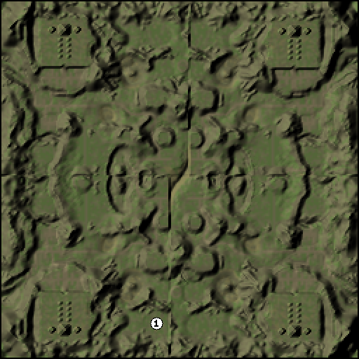

# KnightShiftMinimapGenerator

Minimap generator for **KnightShift** (Polanie II) maps, a command line tool and a .NET library.

Based on [EarthMinimapGenerator](https://github.com/GvardianDLVII/EarthMinimapGenerator) by **GvardianDLVII** (see [Credits](#credits)).



## Features

* generates minimaps that match the in-game minimap (mean difference ~4–5 / 255 per color channel),
* marks player starting positions read from the `.mis` file,
* single map or a whole `Levels` folder at once, PNG or BMP output, any scale,
* `calibrate` mode: adds palettes for new terrain sets from a minimap taken from the game,
* `reconstruct` mode: rebuilds an approximate `.lnd` terrain file from a minimap,
* reads and writes `.lnd` files (re-saving an editor map gives a byte-identical file) and reads the `.mis` header,
* no NuGet dependencies, runs on Windows and Linux (.NET 8).

## Download / building

Prebuilt executables are on the [Releases](https://github.com/A-t-l-as/KnightShiftMinimapGenerator/releases) page.
They are self-contained single files, no .NET installation is needed:

| system | file |
|---|---|
| Windows (64-bit / ARM) | `...-win-x64.zip` / `...-win-arm64.zip` |
| Linux (64-bit / ARM) | `...-linux-x64.tar.gz` / `...-linux-arm64.tar.gz` |
| macOS (Intel / Apple Silicon) | `...-osx-x64.tar.gz` / `...-osx-arm64.tar.gz` |

On Linux and macOS run it from a terminal: `./KnightShiftMinimapGenerator --help`.
The macOS build is not signed, so the first time macOS may block it; allow it in
*System Settings → Privacy & Security* or run `xattr -d com.apple.quarantine KnightShiftMinimapGenerator`.

To build from source you need the [.NET 8 SDK](https://dotnet.microsoft.com/download):

```
cd src
dotnet build -c Release
```

Executable: `src/KnightShiftMinimapGeneratorRunner/bin/Release/net8.0/KnightShiftMinimapGenerator.exe`

Single-file executable (replace `win-x64` with `linux-x64`, `osx-arm64`, ... for other systems):

```
cd src
dotnet publish KnightShiftMinimapGeneratorRunner -c Release -r win-x64 --self-contained true -p:PublishSingleFile=true -o ../publish
```

Pushing a tag `v*` (e.g. `v1.1.0`) makes GitHub Actions build all six platforms and publish them as a release; the program version is taken from the tag.

Run the program without arguments (or with `--help`) to see all modes and options.

## Usage

Single map:

`KnightShiftMinimapGenerator.exe --lnd "D:\Games\KnightShift\Levels\twisted_II_v4.lnd" --o D:\Minimaps\twisted.png --scale 2`

Starting positions are read from the `.mis` file with the same name as the `.lnd` file (or from `--mis <file>`).

Whole folder:

`KnightShiftMinimapGenerator.exe --mode multiple --i "D:\Games\KnightShift\Levels" --o D:\Minimaps --format png`

Map information (size, terrain set, whether a palette for it is available, starting positions):

`KnightShiftMinimapGenerator.exe --mode info --i "D:\Games\KnightShift\Levels"`

Options:

| option | meaning |
|---|---|
| `--scale n` | scale factor, default 1 (one pixel per map vertex, like the game) |
| `--format png\|bmp` | output format in `multiple` mode (in `single` mode the `--o` extension decides) |
| `--noframe` | do not draw the 1 px black frame |
| `--hidestartingpositions` | do not mark player starting positions |
| `--mis file.mis` | MIS file to read starting positions from (single mode; default: same name as the `.lnd`) |
| `--shading 0..1` | relief shading strength |
| `--palettes file.json` | additional terrain palettes, default `palettes.json` next to the executable |

## Terrain sets and calibration

The terrain colors depend on the texture set, i.e. the `terrainId` field of the `.lnd` file. Built-in palettes for five sets were calculated from 8 minimaps taken from the game:

| terrainId (last byte) | reference maps | mean error |
|---|---|---|
| `...00` | aaa, RPG_GE08_0 | 4.5–5.3 |
| `...01` | Twisted Canyons II, RPG_GE08_1 | 4.6–4.8 |
| `...02` | RPG_GE08_2 | 5.6 |
| `...03` | RPG_GE12_0 (The Den) | 5.5 |
| `...04` (winter) | Mage's war II, RPG_GE08_3 | 4.9–8.8 |

The error is the mean difference per color channel (0–255). The remaining difference is mostly fine texture grain, which the game shows on the minimap and the generator draws as a flat color.

For a map with any other terrain set, the program uses a fallback palette and prints a warning. To add the set, one minimap from the game (24-bit BMP) of any map using it is enough:

`KnightShiftMinimapGenerator.exe --mode calibrate --lnd map.lnd --ref minimap.bmp --name "Desert"`

The palette is saved to `palettes.json` next to the executable and used automatically from then on. The program also prints the mean error against the reference.

## Rebuilding an .lnd file from a minimap

`reconstruct` mode creates a terrain file from a minimap taken from the game (24-bit BMP, one pixel per map vertex).
A minimap does not contain all the data of a map, so the result is an **approximation**, a starting point for further work in the editor:

* **water**: placed exactly where the minimap is blue; the water depth is invented (deeper further from the shore),
* **textures**: the nearest texture color of the terrain set after removing the shading; similar textures (two grasses, two kinds of snow) can be mixed up,
* **heights**: "shape from shading": heights are optimized so that the lighting model reproduces the minimap brightness. Hills, valleys, cliffs and rivers end up in the right places, but the absolute height of large plateaus cannot be recovered from shading, so the terrain is flatter than the original.

Recommended workflow:

1. In the editor, create an empty map with the same size and terrain set as the minimap, and save it, e.g. as `Rebuilt` (this creates `Rebuilt.lnd` and `Rebuilt.mis`).
2. Run:

   `KnightShiftMinimapGenerator.exe --mode reconstruct --ref minimap.bmp --template "D:\Games\KnightShift\Levels\Rebuilt.lnd" --o "D:\Games\KnightShift\Levels\Rebuilt.lnd" --preview preview.png`

   The template's header and GUID are kept, so the `.mis` file still matches it. When `--o` is the template itself, a backup copy `.lnd.bak` is made first.
3. Open the map in the editor.

Without a template, `--terrain 00..04` (or a full 32-digit terrain id) and `--name "Title"` create a standalone `.lnd` file; a matching `.mis` file has to be made separately.

`--smoothing` (default `5e-7`) controls how smooth the recovered terrain is: lower values keep more detail but also turn texture grain into bumps.

Tested on the 9 reference maps: the minimap of the rebuilt map differs from the input by 2.8–6.8 / 255, and the recovered heights correlate with the real ones at 0.36–0.81 (best on maps with distinct hills, worst on maps with large plateaus at different heights). The file writer produces byte-identical files to the editor when re-saving an existing map.

## How the game draws the minimap

The model was fitted against minimaps taken from the game:

* **water**: vertex (x,y) is water when `waterHeight[x,y] > max(terrainHeight)` of the 4 corners of the cell (x..x+1, y..y+1). The color is constant: RGB(14,46,255). This matches the game pixel for pixel on all reference maps.
* **land**: the average texture color of the 4 cell corners multiplied by Lambert lighting computed from height differences. Light direction (-0.924, -0.458, 1), height scale 255.8 units per cell, ambient term 0.19.
* **frame**: 1 px black frame.
* The color layers painted in the editor (ARGB) do **not** affect the minimap.

Starting positions are drawn on top as white circles numbered with the player slot (1-16). Players whose markers would overlap (e.g. RPG maps where all players start in one spot) are drawn as one marker with the lowest slot number.

## .lnd file format (KnightShift, version 6)

The file consists of two zlib streams written one after another.

1. Header: `uint32 0x39D0A1FF`, `byte len + name`, `uint32 format` (`'L','D',0,6`), `GUID[16]`
2. Data, as written by the editor save function `FUN_005d2610`:

```
int32  width, height, border(16)
int32  titleLen, char[titleLen] title
byte[16] terrainId                 (version 4 and later)
uint16 terrainHeight[w*h]
byte   layerA[w*h]                 (unknown, usually 64)
byte   texture[w*h]                texture index (& 0x7F), bit 0x80 = variant
uint32 colorA[w*h]                 color painted in the editor
uint32 colorB[w*h]                 color painted in the editor
byte   layerF[w*h]                 (unknown, 0 / 138)
int32  unknown                     (2048)
uint16 waterHeight[w*h]            0 = no water
```

## .mis file header (KnightShift, versions 6-12)

Same container as `.lnd` (`'M','D',0,12`). Header layout from the mission loader `FUN_005e2950`:

```
string  name                       (int32 length + chars)
[v6]    string lndName / [v7+] byte[16] lndGuid
byte    unknown
int32   unknown
uint16  width, height
int32   unknown
[v9+]   int32 unknown, [v11+] int32 unknown
[v12]   string x3
16 x player:
        int32 flags                0 = empty slot
        byte  startX, startY       255,255 = not set
        [v8+] byte, byte           unknown
... objects, scripts (not parsed)
```

## Credits

This project would not exist without **[GvardianDLVII](https://github.com/GvardianDLVII)** and his
**[EarthMinimapGenerator](https://github.com/GvardianDLVII/EarthMinimapGenerator)** for Earth 2150
(InsideEarth Operations). KnightShift is built on the same engine family, and his program gave this one its idea,
its structure (generator library + command line runner, `single` / `multiple` modes, scale option, numbered
starting positions) and its approach of recreating the game minimap from the terrain data.
Thank you, Gvardian!

The KnightShift `.lnd` / `.mis` formats, the minimap lighting model, the terrain palettes and the reconstruction
were worked out for this project by A-t-l-as.

## License

MIT, see [LICENSE](LICENSE). The original copyright notice of EarthMinimapGenerator is kept there.

KnightShift is a trademark of its respective owners. This is an unofficial fan tool; it contains no game files or game code.

